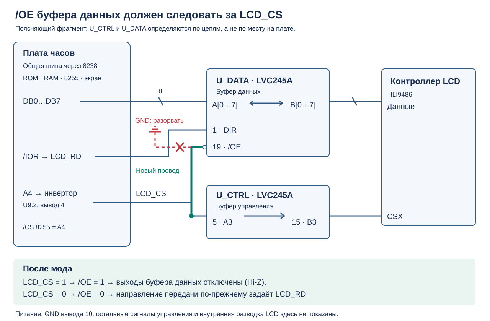
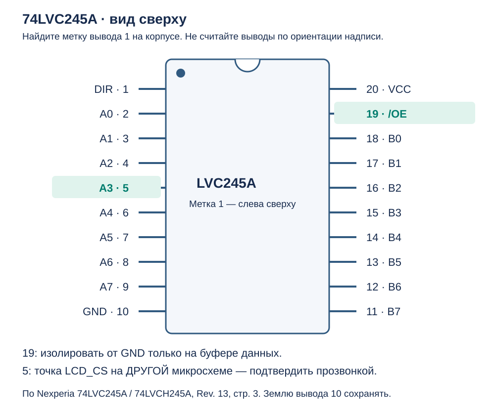
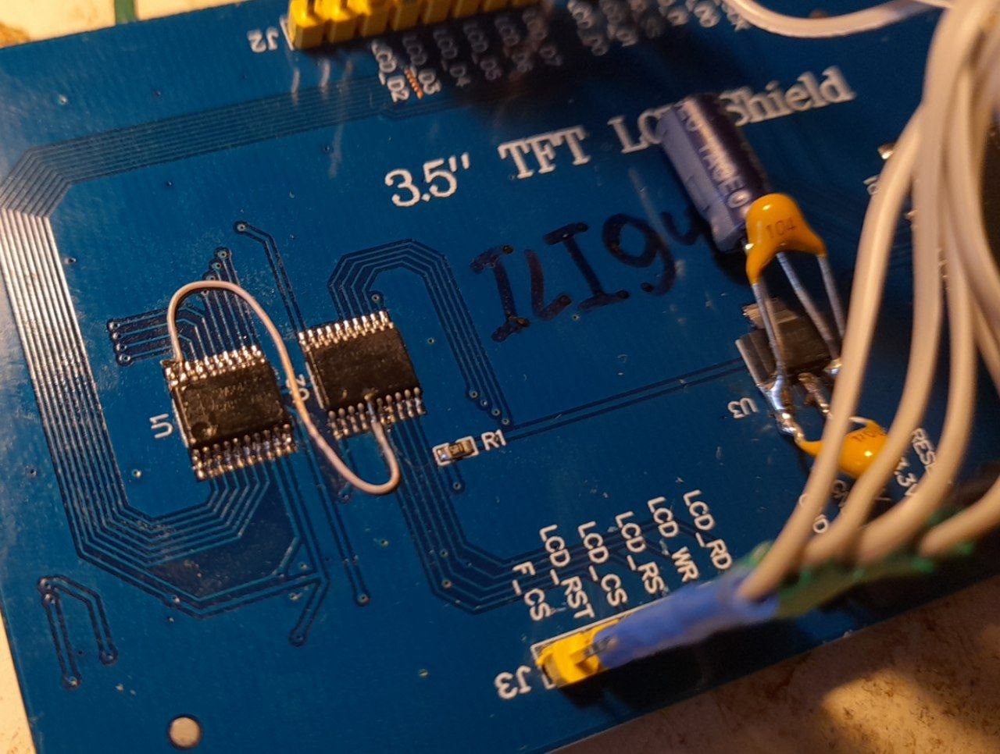

# Доработка TFT-экрана для часов на 8080

Некоторым синим модулям **3,5″ TFT LCD Shield, 480×320, 8-битная параллельная шина** нужна доработка для работы на общей шине данных часов. На показанных платах установлены два шинных приёмопередатчика с маркировкой **LVC245A** (семейство 74LVC245A).

Суть мода: **отсоединить вывод 19 (`/OE`) буфера данных от GND и соединить его проводом с выводом 5 второй микросхемы, на котором находится `LCD_CS`.** Так буфер данных будет включён только при выборе экрана.

> **Главная проверка перед пайкой:** вывод 5 выбранной микросхемы должен звониться с контактом `LCD_CS` разъёма экрана. Номера U1/U2/U3 и расположение корпусов у разных ревизий отличаются. Нельзя выбирать микросхему только по принципу «левая» или «правая».

> **Осторожно с феном:** непосредственно под платой экрана находится ЖК-матрица. Перегрев может необратимо повредить её, поляризатор, подсветку или соединение шлейфа. Для подъёма одного вывода обычно достаточно паяльника; демонтаж корпуса феном требует особенно аккуратной работы.

## Для каких экранов подходит

В приложенном [описании продавца](<TFT ЖК-дисплей 3,5 дюйма EC Buying 480x320 _ AliExpress.pdf>) на странице 4 указаны ILI9486, 480×320 и 8-битный параллельный интерфейс; варианты названы MAR3501/MAR3502. Это описание товара, а не полная принципиальная схема конкретной ревизии. Табличные поля карточки противоречат друг другу: встречается также 320×240. При выборе ориентируйтесь на фактическую плату, контроллер и распиновку.

Мод относится к платам с отдельным двунаправленным буфером данных, у которого `/OE` постоянно подключён к земле. Для другого контроллера, другой логики или уже исправленной ревизии сначала нужно проверить схему соединений. Маркировка ILI9486 сама по себе не означает, что мод необходим.

Все номера **5 и 19** далее относятся к **выводам корпусов микросхем**, а не к контактам разъёма экрана или символа `SCR1` в KiCad. В частности, `SCR1.19` в проекте — это `SD_DO`, к доработке он отношения не имеет.

## Зачем это нужно: конфликт на общей шине

По [схеме платы часов](<../kicad project/CPU.kicad_sch>) и [списку соединений](<../kicad project/8080clock.net>) экран подключён следующим образом:

| Сигнал экрана | Контакт SCR1 в схеме часов | Подключение |
| --- | ---: | --- |
| `LCD_D0…LCD_D7` | 4…11 | Общая шина `DB0…DB7`: 8238, ROM, RAM, 8255 и экран |
| `LCD_CS` | 13 | Инвертированный `A4`, выход U9.2, вывод 4 |
| `LCD_RS` | 14 | `A0`, выбор команды или данных |
| `LCD_WR` | 15 | `/IOW` от U6 (8238), вывод 27; тот же сигнал идёт на 8255 |
| `LCD_RD` | 16 | `/IOR` от U6 (8238), вывод 25; тот же сигнал идёт на 8255 |

Знак `/` означает активный низкий уровень: `/CS = 0` выбирает экран, `/OE = 0` разрешает выходы буфера. На плате подписи могут быть без косой черты.

У 74LVC245A вывод **1 — `DIR`**, направление передачи, а **19 — `/OE`**, разрешение выходов. При `/OE = 1` выходы переходят в высокоимпедансное состояние (Hi-Z), то есть перестают задавать уровень на шине. Настоящий вывод земли у микросхемы — **10**, его отсоединять нельзя. Назначение выводов и таблица состояний приведены в [даташите Nexperia, стр. 3–4](https://assets.nexperia.com/documents/data-sheet/74LVC_LVCH245A.pdf).

В рассматриваемом включении направление буфера данных задаёт `LCD_RD`: при высоком уровне данные идут от компьютера к LCD, при низком — обратно. До мода `/OE` посажен на землю, поэтому буфер включён постоянно.

Отсюда проблема при чтении 8255, например из порта `01h` или `02h`:

1. У адреса `A4 = 0`, поэтому `LCD_CS = 1`: экран не выбран.
2. Общий `/IOR` становится низким и одновременно приходит на `LCD_RD`.
3. Буфер экрана переключается в сторону общей шины, но его выходы по-прежнему разрешены.
4. Отключённый контроллер LCD не выдаёт полезные данные. Однако **Hi-Z на входе буфера не превращает его выход в Hi-Z**: включённый буфер может выдавать неопределённые уровни и конфликтовать с выходами 8255.

Это объяснение следует из схемы общей шины и логики 74LVC245A; это не результат осциллографического измерения данного экземпляра. Возможны неверное чтение кнопок и датчиков, нестабильная работа программы и повышенный ток при противодействии выходов. Отсутствие изображения само по себе ещё не доказывает именно эту неисправность.

После соединения `/OE = LCD_CS` буфер отключается при обращении к 8255. При записи в порты экрана `10h/11h` значение `A4 = 1`, экран выбран и буфер работает. Даже если прошивка только пишет в LCD, мод всё равно нужен для корректного **чтения других устройств** с общей шины. Сам по себе он не требует изменения прошивки.

| Состояние | `LCD_CS` = `/OE` после мода | `LCD_RD` | Буфер данных |
| --- | ---: | ---: | --- |
| Экран не выбран | 1 | Любой | Выходы отключены, Hi-Z |
| Экран выбран, направление записи | 0 | 1 | Шина компьютера → LCD; запись выполняется стробом `LCD_WR` |
| Экран выбран, чтение | 0 | 0 | LCD → шина компьютера |

## Схема доработки

Схема показывает только цепи, необходимые для объяснения мода. `U_CTRL` и `U_DATA` — условные имена **по функции**, а не позиционные обозначения с шелкографии. Соединения основной платы взяты из проекта KiCad; фрагмент модуля поясняет мод на фотографиях и подлежит проверке прозвонкой на вашем экземпляре. Это не заводская схема всех TFT Shield.

**Меняется только `/OE` буфера данных.** Вывод 5 буфера управления остаётся припаянным к своей площадке. Его штатная связь с `LCD_CS` сохраняется. `/OE` самого буфера управления и выводы питания обеих микросхем остаются подключены как прежде.

## Как найти нужные микросхемы и выводы

Обесточьте часы, отсоедините экран от основной платы и любых внешних подключений. Прозвонку выполняйте только на обесточенном модуле.

1. Найдите на корпусах маркировку `LVC245A` и метку первого вывода. Сверьте распиновку именно установленной микросхемы; сходный корпус не гарантирует совместимости.
2. Найдите **буфер данных**: его восемь линий стороны A, выводы 2…9, связаны с контактами `LCD_D0…LCD_D7` разъёма. Порядок битов не определяйте по внешнему виду дорожек. Проверьте также связь вывода 1 (`DIR`) с цепью `LCD_RD`.
3. На **буфере управления** найдите вывод 5 и проверьте его прямую связь с контактом разъёма, подписанным `LCD_CS`. Если связи нет, остановитесь и установите реальную распиновку этой ревизии.
4. До мода проверьте, что вывод 19 буфера данных действительно соединён с GND. Если он уже управляется сигналом выбора, резать эту цепь не нужно.

На схеме распиновки показан **вид сверху на корпус**. Нумерация идёт против часовой стрелки от метки вывода 1. Обозначение `A3` у вывода 5 — имя канала внутри 74LVC245A, а не адресная линия A3 процессора. Его связь с `LCD_CS` задаётся разводкой модуля.

### Ревизия с U3 слева и U2 справа

На следующих двух фотографиях, в показанной ориентации, **U3 слева — буфер управления**, **U2 справа — буфер данных**. Перемычка соединяет **U3.5 → U2.19**. Метки первого вывода находятся у нижних левых углов корпусов: вывод 5 — пятый слева в нижнем ряду, вывод 19 — второй слева в верхнем ряду. Это подсказка только для данной ориентации снимка.

До доработки; на корпусах читается `LVC245A`:

После доработки:

На фото видна перемычка, но не вся изоляция вывода от земли под корпусом. Само наличие провода ещё не подтверждает правильность мода. Для повторения лучше взять более тонкий и короткий изолированный провод, чтобы не нагружать поднятый вывод.

### Ревизия с буфером данных слева

На этом снимке расположение другое: доработанный буфер данных **слева (U1)**, буфер управления **справа (U2)**. Перемычка идёт **U1.19 ↔ U2.5**. Снимок менее чёткий, поэтому назначение цепей обязательно подтвердите прозвонкой.

Другие изменения, видимые на этом снимке, не входят в описанный мод. Повторять нужно только проверенное соединение `/OE` с `LCD_CS` и изоляцию `/OE` от земли.

## Инструменты и подготовка

Нужны мультиметр, хорошее увеличение, паяльник с подходящим тонким жалом, флюс для электроники, немного припоя, оплётка, тонкий пинцет и тонкий изолированный монтажный провод. Для варианта со снятием корпуса дополнительно нужны регулируемая термовоздушная станция и средства защиты соседних деталей от нагрева.

Зафиксируйте модуль за плату так, чтобы не давить на стекло или шлейф. Сфотографируйте ориентацию микросхемы и отметьте выводы 1, 5 и 19 до начала работы.

**Ключевая особенность этих плат:** вывод 19 связан с землёй в том числе **под корпусом**. Перерезание видимого участка меди снаружи может оставить скрытую связь с полигоном GND. Ниже два способа обеспечить реальную изоляцию. Выберите один.

## Способ A: приподнять вывод 19

Этот способ позволяет обойтись без прогрева всего корпуса и без разрезания полигона под ним.

1. Нанесите немного флюса на вывод 19 **буфера данных**. При необходимости уберите лишний припой оплёткой, не перегревая площадку.
2. Прогрейте соединение паяльником и, только пока припой расплавлен, очень аккуратно отделите конец вывода от площадки. Поднимите его ровно настолько, чтобы появился надёжный зазор. Не тяните за холодный вывод и не пытайтесь отогнуть его высоко: можно оторвать площадку или сломать ножку у корпуса.
3. Под увеличением убедитесь, что ножка не касается площадки, припоя, соседних выводов или оголённого полигона. При необходимости подложите небольшой кусочек термостойкой электроизоляции.
4. **До установки перемычки** проверьте сопротивление между поднятой ножкой и GND. Прямого металлического соединения быть не должно. Площадка под ножкой при этом может и должна остаться связанной с землёй — она больше не соединена с ножкой.
5. Припаяйте тонкий провод непосредственно к изолированной ножке 19. Второй конец припаяйте к проверенному выводу 5 буфера управления. Вывод 5 не поднимать и не отсоединять.
6. Уложите провод без натяжения, вдали от разъёмов и острых краёв. После электрической проверки закрепите его изоляцию на плате подходящим электроизоляционным составом, чтобы случайное движение не оторвало ножку.

**Провод должен быть припаян к поднятому выводу, а не к оставшейся под ним заземлённой площадке.** Не включайте модуль с висящим в воздухе `/OE`: сначала завершите подключение и проверку.

## Способ B: снять микросхему и изолировать площадку

Этот способ сохраняет обычную посадку вывода на площадке, но требует демонтажа корпуса.

> **Под платой находится ЖК-матрица. Работайте феном крайне осторожно.** Тепло передаётся через текстолит и медь даже при нагреве только со стороны компонентов. Каптоновая лента защищает от прямого потока и случайного касания, но не устраняет этот нагрев. Металлический защитный экран также не гарантирует сохранность матрицы и не должен замыкать контакты.

Не направляйте горячий воздух на стекло, шлейф и его соединения. Не прогревайте модуль целиком и не повышайте температуру бесконтрольно, если корпус не снимается. Универсальных безопасных «температуры и секунд» здесь нет: результат зависит от станции, сопла, припоя, теплоотвода и конструкции модуля. Используйте минимально достаточные нагрев и поток, контролируйте время и температуру, давайте узлу остывать. Если локальный демонтаж без перегрева матрицы обеспечить нельзя, выберите подъём одного вывода или поручите работу специалисту.

1. Зафиксируйте ориентацию корпуса и защитите соседние элементы. Нанесите флюс.
2. Локально прогрейте микросхему и снимите её только после расплавления припоя на всех выводах. Не поддевайте и не отрывайте корпус силой.
3. После остывания осмотрите площадку вывода 19. Найдите **все** её соединения с GND, включая медь, которая была скрыта под микросхемой.
4. Аккуратно разорвите только подводы земли к площадке 19. Не режьте плату глубоко, не повреждайте соседние дорожки, переходные отверстия и землю вывода 10. Если площадка связана с землёй через недоступное отверстие или внутренний слой, не углубляйте разрез вслепую — используйте изоляцию самой ножки.
5. Удалите медные стружки и остатки припоя. **Пока микросхема снята**, мультиметром убедитесь, что площадка 19 изолирована от GND, а земля остальных цепей сохранена.
6. Установите микросхему обратно в исходной ориентации и припаяйте все выводы. После остывания повторите проверку: припой мог снова замкнуть площадку 19 на край полигона.
7. Подпаяйте провод сверху между выводом 19 буфера данных и проверенным выводом 5 буфера управления. Проверьте соединения и закрепите провод без натяжения.

## Проверка перед первым включением

Сначала осмотрите пайку под увеличением. Затем на отключённом от часов модуле проверьте:

- **19 → GND:** нет прямого короткого замыкания. Особенно важна проверка до подключения провода, когда другие цепи ещё не влияют на измерение.
- **19 → 5 второй микросхемы → `LCD_CS` разъёма:** есть надёжная непрерывная связь.
- **10 → GND:** земля буфера данных сохранена.
- **Соседние выводы:** возле 19 нет перемычек на 18 и 20; возле 5 — на 4 и 6.
- **Питание → GND:** нет короткого замыкания, появившегося после пайки. После снятия корпуса осмотрите оба ряда выводов на мостики и непропаи.
- **Механика:** ножка и провод не касаются заземлённой меди, соседних деталей и металлических частей экрана даже при установке модуля в часы.

Не ограничивайтесь звуковым сигналом мультиметра. Защитные переходы микросхем и заряд конденсаторов могут влиять на показания; сравнивайте сопротивление в обеих полярностях и отличайте их от устойчивого сопротивления, близкого к сопротивлению замкнутых щупов. Для снятой микросхемы проверка изолированной площадки наиболее однозначна. При сомнении в изоляции питание не подавайте.

Если земля под выводом 19 осталась, провод замкнёт `LCD_CS` на GND. В часах этот сигнал задаёт выход инвертора U9.2: такое подключение перегружает его выход и оставляет экран постоянно выбранным. **Припаять только провод, не устранив связь с землёй, нельзя.**

## Проверка в часах

1. Подключите модуль при выключенном питании, проверьте ориентацию разъёмов. В этой схеме питание экрана идёт на вход `5V` от `+5MAIN`, а контакт `3V3` символа SCR1 не подключён. Питание модуля 5 В не означает, что 5 В допустимы на выводе питания 74LVC245A; штатное преобразование уровней и питание буферов сохраняются.
2. Выполните первое включение от штатного исправного питания; при наличии лабораторного источника используйте подходящее для всей платы ограничение тока. При необычном токе или быстром нагреве сразу отключите питание и проверьте монтаж.
3. Проверьте старт, изображение и обновление экрана, затем кнопки и чтение установленных RTC/датчиков через 8255. Проверка только картинки не подтверждает, что конфликт шины устранён.
4. Если есть осциллограф или логический анализатор, сравните `LCD_CS` и вывод 19 буфера данных: уровни должны совпадать. Во время чтения портов 8255 `00h…03h` вывод 19 должен оставаться высоким, в том числе при низком `LCD_RD`. Сам по себе логический анализатор не доказывает Hi-Z; для оценки возможного конфликта полезен осциллограф на линиях данных.

Если результат нестабилен, сначала перепроверьте выбор микросхем, связь вывода 5 с `LCD_CS`, скрытое соединение 19 с землёй, соседние пайки, питание и сброс. Исправление конфликта буфера не заменяет правильного подключения и подходящей инициализации контроллера.

## Источники и границы проверки

- **Фотографии автора проекта:** три снимка выше показывают две реальные ревизии и точки установки перемычки. Скрытая земля под корпусом описана автором по опыту доработки.
- **Проект часов:** [CPU.kicad_sch](<../kicad project/CPU.kicad_sch>), [8080clock.net](<../kicad project/8080clock.net>), [PDF схемы, лист CPU](<../kicad project/docs/8080clock.pdf>). Назначение соединений проверено по netlist; при расхождении старого PDF с исходниками ориентируйтесь на актуальную схему KiCad.
- **Описание продавца:** [сохранённая карточка AliExpress, стр. 4](<TFT ЖК-дисплей 3,5 дюйма EC Buying 480x320 _ AliExpress.pdf>), характеристики и обозначения контактов. Нумерация строк в карточке отличается от нумерации SCR1, поэтому ориентируйтесь на имена сигналов.
- **Nexperia:** [74LVC245A / 74LVCH245A, Rev. 13](https://assets.nexperia.com/documents/data-sheet/74LVC_LVCH245A.pdf), стр. 3–4 — распиновка и логика `/OE`/`DIR`; стр. 5 — допустимые рабочие напряжения.
- **LCDWiki:** [руководство MAR3501](https://www.lcdwiki.com/res/MAR3501/3.5inch_Arduino_8BIT_Module_MAR3501_User_Manual_EN.pdf), стр. 4–7 — интерфейс и работа сигналов управления; [даташит ILI9486](https://www.lcdwiki.com/res/MAR3501/datasheet_ILI9486.pdf), стр. 12 и 31 — `CSX` и цикл чтения. Эти материалы описывают интерфейс и контроллер, но не удостоверяют разводку каждой ревизии модуля.

Иллюстрации в `assets` подготовлены для этого руководства. Назначение выводов сверено с даташитом; выполнение пайки, прозвонка конкретного экземпляра и проверка после включения остаются обязательными.
