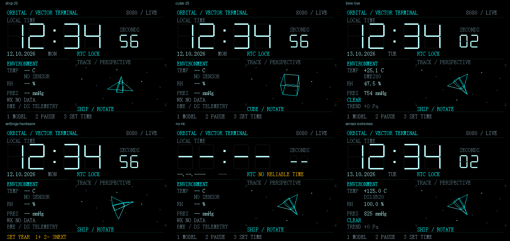

# Orbital / Vector Terminal — Intel 8080 clock firmware

Commented sources for the accepted **vector-terminal v2**. The firmware runs on
the physical 3.555556 MHz Intel 8080 / KR580VM80 clock board with a 480 x 320
parallel RGB565 display, PCF8563 RTC, BME280 and two-wire DS18B20.



The English UI combines a large clock, sensor telemetry, pressure-based weather
trend, a star field and a rotating 3-D ship or cube. Geometry uses integer Q6
rotation and perspective, not pre-rendered frames. The next animation scene is
prepared in small palette masks; changed nonblack pixels are written before
obsolete pixels are removed. This avoids the previous whole-object blink.

## Build

On Windows, install Python 3.9+ and run from this folder:

```bat
setup-env.bat
build.bat vector-terminal all
```

Setup installs the pinned z88dk 2.4 toolchain inside `.tools` and checks its
archive hash. The toolchain can be reused offline. Firmware itself requires
no network, SD card, sound or emulator.

| Output | Use |
| --- | --- |
| `build/vector-terminal/hardware/rom.bin` | Physical 27C256, linear image from 0000h |
| `build/vector-terminal/emulator/emulator.bin` | Project emulator with virtual RTC ports |

Both are exactly 32768 bytes. Flash **hardware/rom.bin** to the board.
Compiled images and the compiler are generated locally and are not in this
source kit. The GUI emulator can be used from the full project checkout;
the unchanged CPU core is included here for automated verification.

## Verify

Install Clang with the Windows SDK, then:

```bat
verify.bat vector-terminal
python variants\vector-terminal\tests\startup_pause.py
```

Verification compares CRT-decompressed DATA with compiler output and executes
60 million emulator-target CPU cycles with RTC input, tracking LCD and memory
bounds. The BME test runs the hardware ROM with scripted physical bus packets.
Full-project geometry/button/calendar/A-B suites and their fixture requirements
are described in the [source guide](variants/vector-terminal/SOURCE.md).

Expected output SHA256:

```text
hardware  f253f3194292b9d76030fa70b23b0557b0fd9c4bbe4e186e9801b234e3af46cd
emulator  fa81d69c63da051c132b60bade69fce2248875aace47aa72429b751cad451729
```

## Controls

| Button | Normal screen | Time setting |
| --- | --- | --- |
| SW1 / 1 | Ship / cube | Increment |
| SW2 / 2 | Pause / run | Decrement |
| SW3 / 3 | Enter time setting | Hour, minute, weekday, date, month, year, exit |

Pause completes an in-progress scene. Buttons use nonblocking debounce and
accept one action per press. Time and sensors continue during animation.
Missing sensors and unreliable RTC display placeholders.

## Source layout and measured limits

Start with `main.c`, `terminal.c`, `vector.c` and `vector_delta.c` under
`variants/vector-terminal/src`. Their comments explain scheduling, geometric
bounds, bit-plane encoding, 8080 assembly and output ordering. The
[source guide](variants/vector-terminal/SOURCE.md) documents every module and
the frame state machine. [Hardware](docs/HARDWARE.md) and
[build](docs/BUILD.md) documents preserve the project's platform details.

Hardware ROM uses 27831 bytes, static RAM 24358 bytes. The animation uses two
three-bit scenes for a 244 x 111 window, not a full-screen framebuffer.
Measured full-main hardware paths average 1.253 FPS for the ship and 1.179 FPS
for the cube at 3555556 Hz. These are CPU-core cycle measurements; user feedback
confirmed that v2 was significantly more comfortable to view and selected it
as the main version.

[A/B evidence](variants/vector-terminal/evidence/anti-flicker.json) tracks every
LCD pixel write. [Animation](variants/vector-terminal/evidence/anti-flicker.gif)
shows old/new instruction-driven transitions, rather than a physical video.
Hardware/EMU startup verification outputs are regenerated by `verify.bat`.

This kit can be unpacked into a new folder or copied into the existing project
with the same directory layout. Shared build/core files are unchanged copies.
It includes current sources, provenance, build support, verification, comments
and evidence; compiler downloads, generated executables and old release binaries
are omitted. `SOURCE-MANIFEST.json` records every included file's SHA256.
Inherited attribution remains in its source files; the emulator core's MIT
license is preserved in `emulator/LICENSE`.
